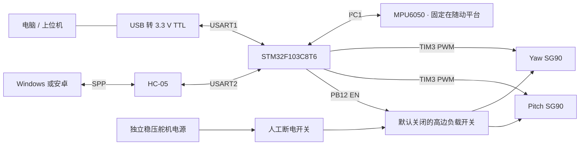

# 接线、上板与验收

## 电气拓扑

| 接口 | 接线 |
| --- | --- |
| 电脑 | PA9/TX → USB-TTL RX，PA10/RX ← USB-TTL TX，GND 共地；115200、8N1 |
| HC-05 | PA2/TX → HC-05 RX，PA3/RX ← HC-05 TX，GND 共地。模块工作在数据模式，TTL 波特率 9600、8N1；已改过参数的模块须先核对 |
| MPU6050 | PB6/SCL、PB7/SDA。使用适配 3.3 V 逻辑的模块，引脚上拉到 3.3 V。坐标轴在初次接入时逐轴确认 |
| SG90 | PB0/TIM3_CH3 → yaw 信号，PB1/TIM3_CH4 → pitch 信号。两只舵机的电源来自受控支路 |
| 断电 | PB12 只驱动高有效、兼容 3.3 V 的负载开关 EN，EN 外部下拉使复位时也保持关断。电源、开关和连接线按两只舵机的实际电流选型 |

主控独立供电，主控、传感器、UART 与执行器共地。USB-TTL 只连 TX、RX、GND。固定线束、机械限位和人工断电开关后再上支架。任务一现场记录过按压接点时舵机才动作，先用同一只空载舵机和已知可用线束依次测试两个信号口。

## 上板顺序

1. 断开舵机支路，连接 J-Link、USB-TTL 和 IMU，烧录 Debug ELF。观察串口、复位和静止校准。用万用表或示波器检查关断时舵机支路电压，并检查重新上电、复位和断开供电时的状态。
2. 保持底座静止完成校准。手转平台并观察三轴波形，记录每个方向、角度符号和近似幅值。安装基准约定水平放置时 Z 轴测得约 +1 g，俯仰转动绕平台 Y 轴，偏航绕平台 Z 轴；装配不符时先变换传感器轴映射。
3. 卸下连杆或负载，舵机先置于安全中位。实测每轴中位、最大安全范围、方向、死区和回差。先小幅逐轴动作，确认反馈方向，再安装连杆。第一次解锁由专人守在断电开关旁。
4. 电脑连接 USB 串口，HC-05 与另一串口或安卓蓝牙串口工具配对。用蓝牙定期发送 `PING`，等状态变为 `READY` 后人工发送 `ARM`，再发送小角度 `TARGET`。停止发送心跳，测量支路断电延迟，确认重连后必须重新操作。双端均可发送 `STOP`。
5. 记录静止平台、缓慢扰动底座以及在线修改滤波权重的曲线和视频。在故障试验中依次验证无心跳、损坏的指令、IMU 数据失效和控制超期。记录触发、状态、PWM 及支路断电时间；运动受阻先做软件注入，并检查独立硬件针对过流的保护。

SG90 不向主控返回轴角或电流。持续跟踪误差保护能识别部分异常。舵机支路的实测断电能力、硬件过流保护与可立即操作的断电开关，决定了实物系统能覆盖哪些堵转工况。

## 必须保留的测量

| 试验 | 工况与判读 |
| --- | --- |
| 闭环带宽 | 固定底座，逐轴施加小幅单频正弦目标，保留各频点输入/输出和采样率。相对低频增益下降 3 dB 的频率应 ≥2 Hz。没有测到交点时报告测量范围 |
| 阶跃 | 两轴分别试正负方向。≤10° 阶跃检查进入并保持在幅值 ±5% 内的时间、稳态误差；约 30° 阶跃检查进入并保持在 ±2° 的时间。若机械行程不足，记录可测范围 |
| 重复与绝对指向 | 从两个方向各重复至少 10 次，保存外部角度参考和对应两轴目标。计算逐次误差及双轴合成误差，记录参考精度、基准零点和校准后的时间 |
| 静态抖动 | 稳定工况连续记录 60 s，分别计算每轴原始角度峰峰值。固定相机配标记或测角仪可用于区分实体抖动与 IMU 噪声 |
| 实时性 | 有线绘图和蓝牙命令同时运行时记录控制执行时间及漏周期计数。要测逐周期抖动，使用计时引脚或调试跟踪记录真实任务起点，与定时触发时刻对照 |

每组测量保存固件提交号、参数、供电、负载、机械零点、原始 CSV、外部参考和测试视频。六轴 IMU 的重力观测可以校正俯仰与横滚，绕重力轴的 yaw 靠陀螺积分，会随时间漂移。绝对指向用独立参考判定。额外选定的 60 s 与重复次数是本工程的测试口径。
